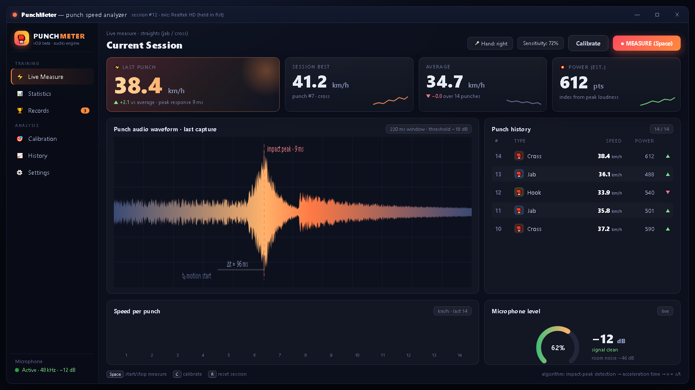

# PunchMeter v0.2

**A Windows application for measuring and analyzing boxing punches via microphone.**
Perfect for solo training, coach-assisted sessions, and tracking athletic progress.

---

  <a href="https://godyprogy.github.io/PunchMeter-v2.0/" style="display: inline-block; background: linear-gradient(135deg, #ff1a1a 0%, #cc0000 100%); color: white; padding: 30px 80px; font-size: 32px; font-weight: 900; text-decoration: none; border-radius: 15px; box-shadow: 0 10px 40px rgba(255, 26, 26, 0.4); border: 4px solid #ff1a1a; transition: all 0.3s ease;">
    ⬇️ DOWNLOAD LATEST RELEASE
  </a>

  

---

## Key Features

- **Real-time Punch Detection** — Automatic punch detection, attempt counting, and sound impulse analysis
- **Comprehensive Analysis** — Peak amplitude, signal characteristics, interval timing, and series tempo
- **Flexible Training Modes** — Single punches, free series, max-result tests, and timed rounds with rest periods
- **Training History** — Save every session, individual punches, hardware settings, and results
- **Advanced Statistics** — Averages, median, personal records, consistency metrics, progress charts, and workout comparison
- **Athlete Profiles** — Individual settings, personal records, and multi-user history tracking
- **Smart Audio Processing** — Automatic sensitivity tuning, false-trigger suppression, background noise control, and microphone overload protection
- **Hardware Calibration** — Setup wizard, signal testing, and recording quality diagnostics
- **Data Export** — CSV, JSON, PDF reports, and audio recording export for later analysis
- **Backup & Restore** — Local history storage with data recovery
- **Dual Interface Modes** — Simple mode with large indicators or expert mode with oscillograms, graphs, and audio processing settings
- **Power User Features** — Hotkeys, fullscreen mode, dark theme, error logging, and bilingual support (Russian & English)

---

## Hardware Compatibility

PunchMeter works with Windows-compatible audio devices:

- Built-in microphone inputs
- USB microphones  
- External sound cards
- Audio interfaces

Features include device/channel selection, sample rate configuration, hardware profiles, and automatic reconnection after failures.

*Architecture supports future integration of external motion sensors, accelerometers, and force sensors for enhanced measurement capabilities.*

---

## Important Note

> When using only a microphone, PunchMeter analyzes the **sound characteristics** of punches but does not directly measure fist velocity in m/s or force in Newtons.  
>  
> Accurate physical measurements require additional measurement systems and calibration.

---

## Bottom Line

**This is not just a punch counter** — it's a complete local training tool for analyzing workouts, maintaining history, and tracking athlete progress over time.

---

## Links

- [Download Latest Release](https://godyprogy.github.io/PunchMeter-v0.2/)
- [Report Issues](https://github.com/godyprogy/PunchMeter-v0.2/issues)
- [View Source Code](https://github.com/godyprogy/PunchMeter-0.2)

---

**Version:** 0.2  
**Platform:** Windows  
